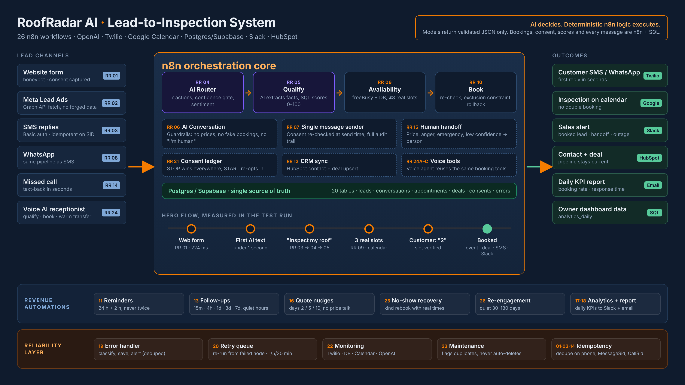

# Case study: RoofRadar AI

**Role:** AI Automation Engineer (design, n8n build, AI prompts and guardrails, database, testing): Fatima Ali
**Demo client:** PrimeHome Roofing (NY/NJ)
**Stack:** n8n · OpenAI · Twilio SMS / WhatsApp / Voice · Google Calendar · Postgres / Supabase · Slack · HubSpot

## The problem

Roof repairs and replacements are high-value jobs, and homeowners usually book whoever answers first. The people
who should answer are on roofs, driving or quoting jobs.

- **Slow first response.** Web and Facebook leads arrive at night; the office replies the next morning.
- **Missed calls stay missed.** Voicemail sends the homeowner to the next roofer on the list.
- **Booking is back-and-forth**, and two people on one calendar cause double bookings.
- **No follow-up** on quiet leads, no-shows and open quotes.
- **AI chatbots are risky:** invented prices, promised times that aren't free, texting after STOP.

## The solution

26 n8n workflows that reply to every lead in seconds, qualify it, and book a free inspection into the real
calendar. The team only handles conversations the system hands over.

**Core rule: AI decides, deterministic n8n logic executes.** Models return validated JSON only. Availability,
bookings, consent, scores, CRM writes and every outbound message are n8n and SQL.

The full path step by step: [END_TO_END.md](END_TO_END.md).

## Engineering decisions

| Decision | How | Why a client cares |
|---|---|---|
| AI output is a decision, not an action | Strict JSON, validated; low confidence → person | The bot can't book or promise anything on its own |
| Only offered slots can be booked | Chosen time must match a slot n8n offered | No invented availability |
| No double booking | Live re-check + Postgres exclusion constraint + Google rollback | Two leads never get the same slot |
| Lead score is SQL | `rr_score_lead`, 0–100 | Explainable, consistent |
| One message sender | RR 07 re-checks consent at send time | STOP honoured everywhere, audit trail |
| Idempotent webhooks | Dedupe on phone, MessageSid, CallSid | Twilio retries never double-text |
| Self-healing | RR 19 classifies, RR 20 re-runs from the failed node (1/5/30 min) | Outages recover without duplicates |
| Monitoring | RR 22 checks Twilio, DB, Calendar, OpenAI every 5 min | Owner hears first |
| Configuration, not code | `organizations.settings` | New client = SQL, not a rebuild |
| Workflows as code | Python generator + `deploy.py` | Repeatable, reviewable deploys |

## Proof

| Scenario | Workflows | Result |
|---|---|---|
| Web form lead | 01 → 06 → 07 | Saved in 224 ms; personalised first text |
| "Yes, I need someone to inspect my roof." | 03 → 04 → 05 → 09 → 06 → 07 | Urgency HIGH; 3 real times offered |
| "2" | 03 → 04 → 10 → 12 → 07 | Booked; appointment, deal, confirmation, Slack |
| "How much does a new roof cost?" | 03 → 04 → 15 → 07 | No price; HUMAN_HANDOFF; AI paused; Slack |
| Missed call | 14 → 07 | Text-back in seconds |
| Same Twilio message twice | 03 | Processed once |
| "STOP" | 03 → 21 | Opted out; follow-ups cancelled |

34 executions, 0 failures. Screenshots in [screenshots/](screenshots/); video in
[media/roofradar-demo-flagship.mp4](../media/roofradar-demo-flagship.mp4).
External APIs were local stand-ins returning real response formats ([test/lab](../test/lab/README.md)); the same
workflows were earlier deployed on n8n Cloud, where calendar booking and Slack alerts were confirmed with live accounts.

## Beyond roofing

The vertical layer (prompts, services, scoring, settings) is configuration, so the same core runs solar
consultations, real-estate viewings, HVAC, plumbing, med spas and clinics.
