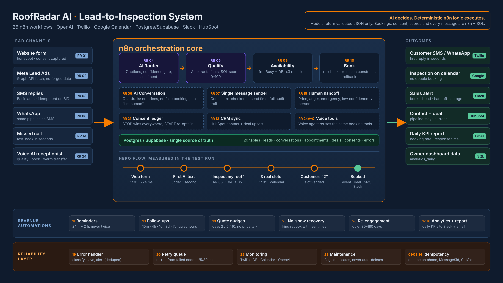

# The flagship flow: web form to booked inspection

This is the one workflow path every demo shows. Times are from the recorded test run (n8n 1.123, PostgreSQL 16).

| # | What the customer sees | What runs | Guarantee |
|---|---|---|---|
| 1 | Submits the PrimeHome form at 9:12 PM: roof leak, Newark NJ, SMS consent ✔ | **RR 01** Inbound Website | E.164 phone, honeypot, dedupe by phone → email, consent recorded. 224 ms |
| 2 | *"Hi John, thanks for contacting PrimeHome Roofing about your roof leak…"* | **RR 06** → **RR 07** | AI writes inside guardrails; RR 07 is the only sender and re-checks consent. Under 1 s |
| 3 | Replies *"Yes, I need someone to inspect my roof."* | **RR 03** → **RR 04** → **RR 05** | Idempotent on MessageSid; router returns validated JSON; lead score is SQL (`rr_score_lead`) |
| 4 | Gets 3 real times | **RR 09** → **RR 06** → **RR 07** | Google `freeBusy` + DB, business hours, notice, horizon; AI never writes a time |
| 5 | Replies *"2"* | **RR 03** → **RR 04** | The slot must be one the system offered |
| 6 | *"Your PrimeHome Roofing roof inspection is confirmed for Tuesday, Nov 10 at 9:00 AM…"* | **RR 10** → **RR 12** → **RR 07** | Live re-check → Google event → DB exclusion constraint (rollback on conflict) → deal → CRM |
| 7 | — | **RR 10** Slack | `🔥 NEW BOOKED LEAD` to `#roofradar-leads` with name, problem, address, time, score |

Then, on schedule: **RR 11** reminders 24 h and 2 h before, **RR 25** rebooking if marked no-show, **RR 17/18** KPIs.

## Proof

| Step | Screenshot |
|---|---|
| All workflows deployed | [01-all-workflows-live.png](screenshots/01-all-workflows-live.png) |
| 1 · lead saved | [02-web-lead-intake.png](screenshots/02-web-lead-intake.png) |
| 3 · AI decision validated | [03-ai-router-decision.png](screenshots/03-ai-router-decision.png) |
| 6 · booked, no double booking | [04-booking-no-double-booking.png](screenshots/04-booking-no-double-booking.png) |
| Guardrail · price question → human | [05-price-question-human-handoff.png](screenshots/05-price-question-human-handoff.png) |
| Recovery · missed call text-back | [06-missed-call-text-back.png](screenshots/06-missed-call-text-back.png) |
| Every execution succeeded | [07-execution-log-all-success.png](screenshots/07-execution-log-all-success.png) |

Video: [media/roofradar-demo-flagship.mp4](../media/roofradar-demo-flagship.mp4) (91 s).
Reproduce it yourself: [test/lab/README.md](../test/lab/README.md).

**Test setup.** External APIs (OpenAI, Twilio, Google Calendar, Slack) were answered by local stand-ins that return
each API's real response format, so every n8n node, SQL statement and branch ran for real. Live-account checks are
listed in [TEST_MATRIX.md](TEST_MATRIX.md).
